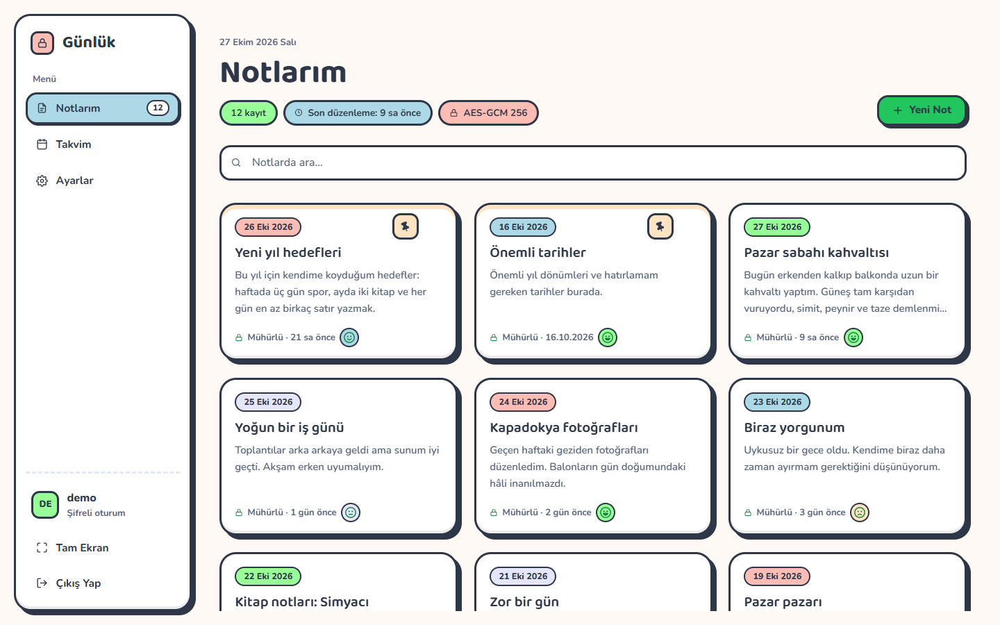
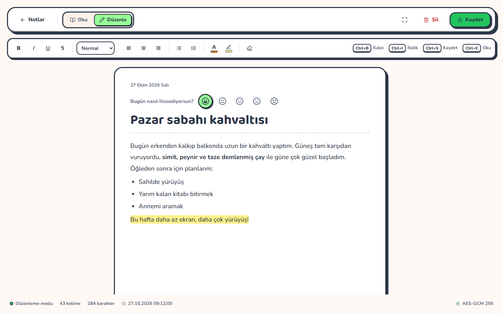
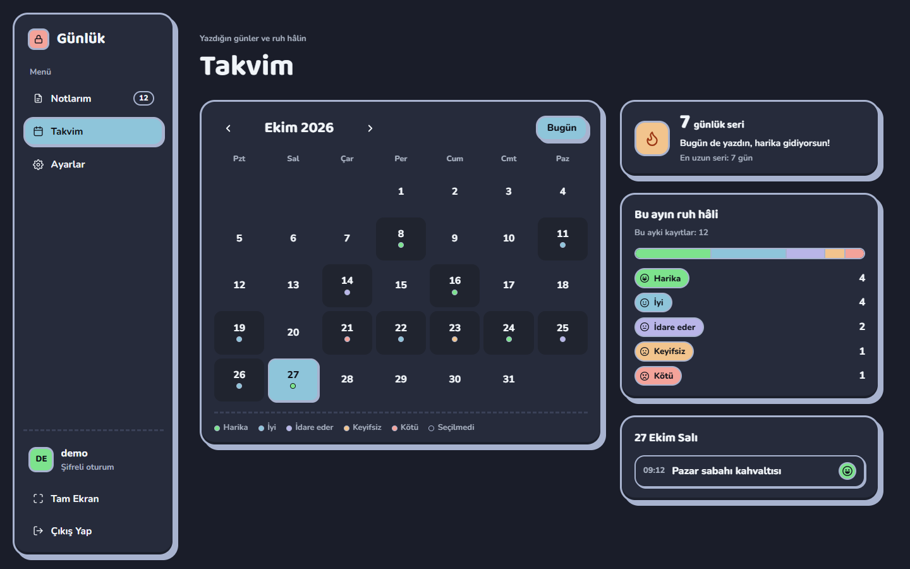
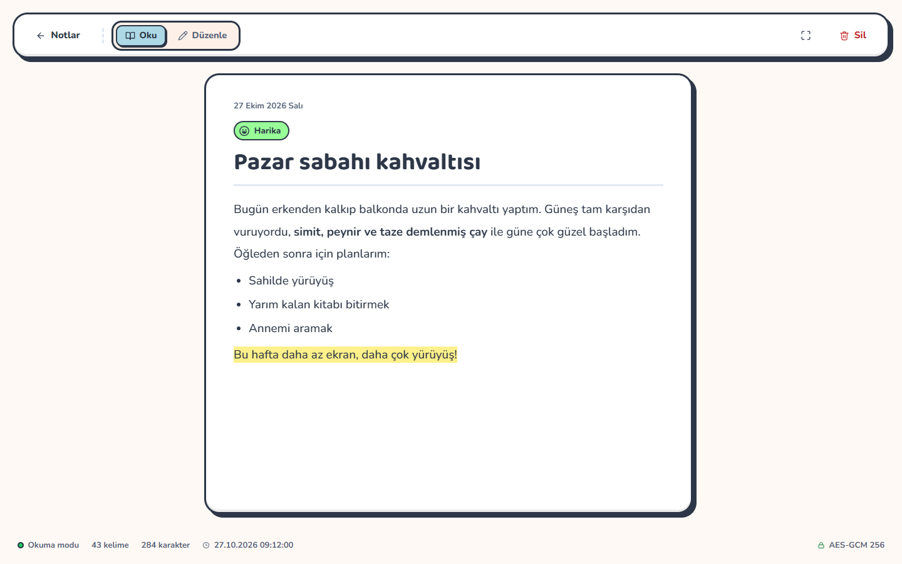
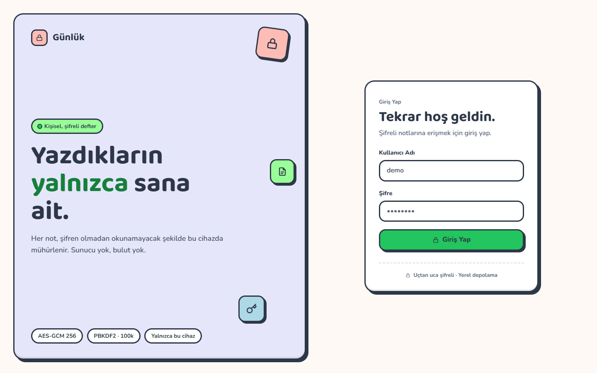
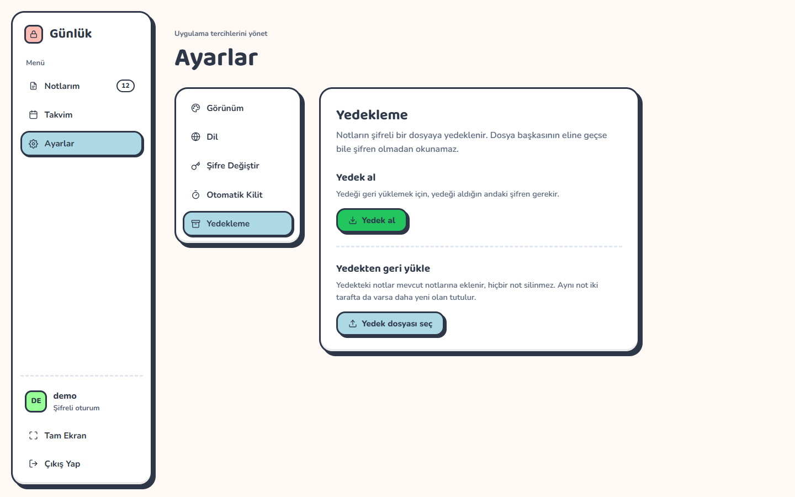
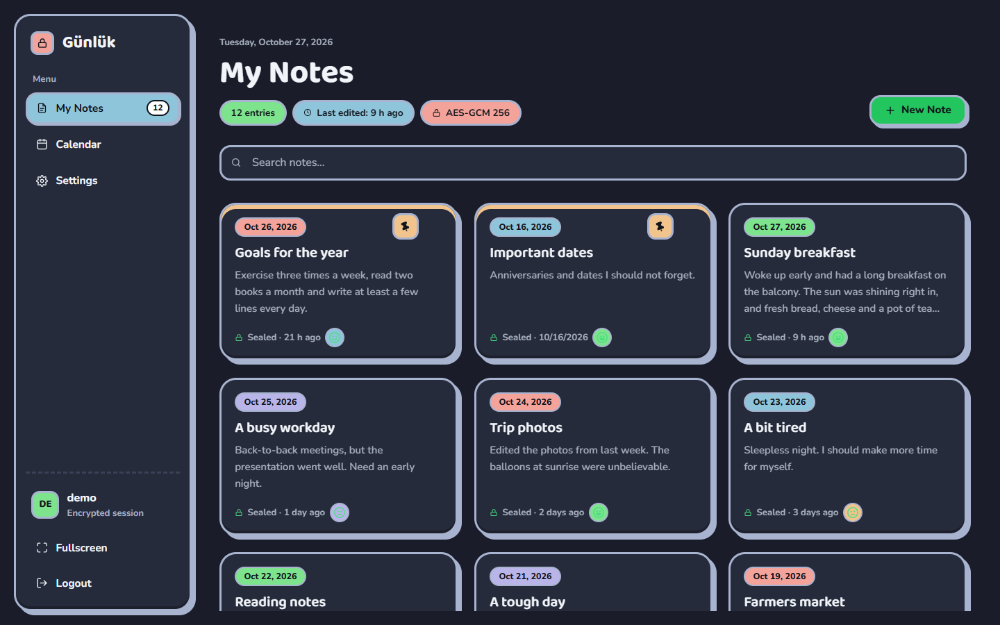
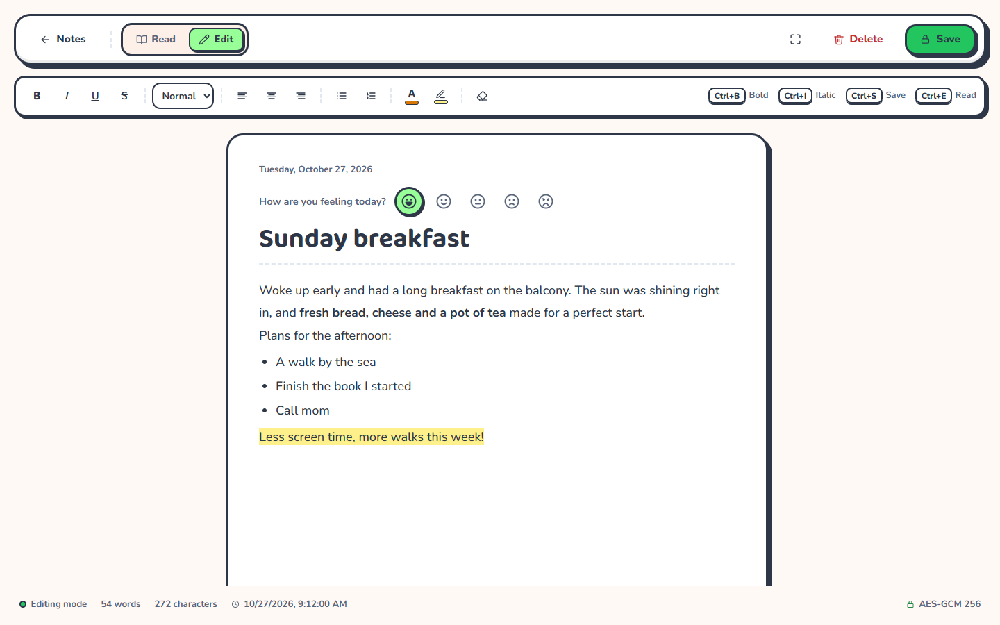
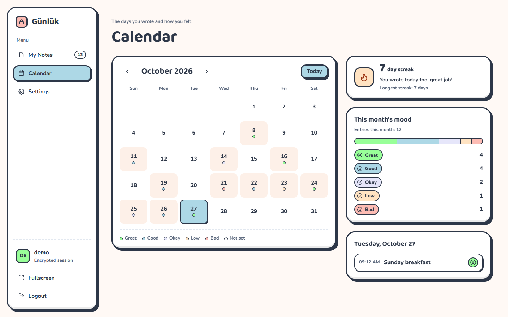
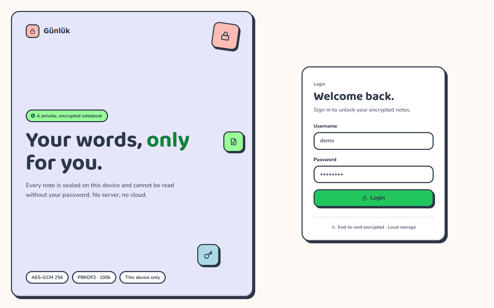

# CryptexNote

**Uçtan uca şifreli, tamamen çevrimdışı çalışan kişisel not defteri ve günlük.**
**An end-to-end encrypted, fully offline personal notebook and journal.**

[Türkçe](#türkçe) · [English](#english)


---

## Türkçe

CryptexNote, notlarını yalnızca senin şifrenle açılabilecek şekilde bilgisayarında saklayan bir masaüstü uygulamasıdır. Sunucu yok, bulut yok, hesap açma yok: her şey kendi cihazında, şifreli olarak durur.

> **Not:** Bu, CryptexNote'un React + Electron ile baştan yazılmış ikinci neslidir. Eski Python/Tkinter sürümü [`1.0` etiketinde](https://github.com/yigitfevzitugrul/CryptexNote/tree/1.0) ve [Releases](https://github.com/yigitfevzitugrul/CryptexNote/releases) sayfasında durmaktadır.



### Ekran görüntüleri

| Düzenleme modu ve ruh hâli | Takvim ve yazma serisi (karanlık tema) |
|---|---|
|  |  |
| **Okuma modu** | **Giriş ekranı** |
|  |  |
| **Şifreli yedekleme** | |
|  | |

> Ekran görüntülerindeki notlar örnek amaçlı oluşturulmuş demo içeriklerdir.

### Özellikler

**Güvenlik**
- Her not **AES-GCM 256-bit** ile şifrelenir; anahtar şifrenden **PBKDF2-SHA256 (100.000 tur)** ile türetilir.
- Şifren hiçbir yerde saklanmaz. Diskte yalnızca şifreli veriler bulunur.
- **Otomatik kilit:** Seçtiğin süre (1–60 dk) boyunca işlem yapılmazsa defter kilitlenir ve anahtar bellekten silinir. Kaydedilmemiş değişiklikler kilitlenmeden önce kaydedilir.
- **Şifreli yedekleme:** Notlarını şifreli bir dosyaya yedekleyip başka bir bilgisayarda geri yükleyebilirsin. Yedek alındıktan sonra şifre değiştirilmiş olsa bile geri yükleme çalışır.
- **Güvenli yapıştırma:** Web'den yapıştırılan içerikteki script, resim ve zararlı kodlar temizlenir; yalnızca temel biçimlendirme kalır.
- **Tamamen çevrimdışı:** Fontlar dahil her şey uygulamanın içindedir; internete hiçbir istek gitmez.

**Yazma**
- Zengin metin editörü: kalın, italik, altı/üstü çizili, yazı boyutu, hizalama, listeler, yazı ve vurgu rengi.
- **Okuma ve düzenleme modu:** Notlar okuma modunda açılır, yanlışlıkla değiştirilmez. `Ctrl+E` ile düzenlemeye geçilir.
- **Ruh hâli:** Her nota bir ruh hâli eklenebilir (Harika, İyi, İdare eder, Keyifsiz, Kötü).
- Kaydedilmemiş değişiklik varken çıkmaya çalışınca uyarı gösterilir.
- Kelime ve karakter sayacı.

**Düzen**
- **Sabitleme:** Önemli notlar listenin en üstünde kalır.
- **Takvim:** Hangi günlerde yazdığını ruh hâline göre renklendirilmiş olarak görürsün; günlere tıklayıp notlarını açabilirsin.
- **Yazma serisi:** Kaç gündür aralıksız yazdığını ve en uzun serini takip eder.
- **Aylık ruh hâli dağılımı.**
- Başlık ve içerikte arama.

**Kişiselleştirme**
- Aydınlık ve karanlık tema.
- Türkçe ve İngilizce arayüz.
- Telefon genişliğine kadar uyumlu, klavye ile kullanılabilir ve erişilebilir arayüz.

### Güvenlik modeli

| Konu | Ayrıntı |
|---|---|
| Şifreleme | AES-GCM, 256-bit anahtar, her şifrelemede rastgele 12 baytlık IV |
| Anahtar türetme | PBKDF2-SHA256, 100.000 tur, kullanıcı adı salt olarak kullanılır |
| Şifre doğrulama | Şifre saklanmaz; doğru şifreyle çözülebilen küçük bir kontrol değeri saklanır |
| Depolama | Uygulamanın yerel deposu (Electron `userData` klasörü) |
| Ağ | Hiçbir veri dışarı gönderilmez |

> ⚠️ **Şifreni unutursan notlarına bir daha erişemezsin.** Şifre aynı zamanda şifreleme anahtarı olduğu için sıfırlama yöntemi yoktur. Şifreni güvenli bir yerde sakla ve düzenli yedek al.

### Kurulum

**Gereksinimler:** [Node.js](https://nodejs.org/) 20.19+ veya 22.12+ ve npm.

```bash
git clone https://github.com/yigitfevzitugrul/CryptexNote.git
cd CryptexNote
npm install
```

| Komut | Açıklama |
|---|---|
| `npm run electron:dev` | Masaüstü uygulamasını geliştirme modunda başlatır |
| `npm run dev` | Uygulamayı tarayıcıda açar (`http://localhost:5173`) |
| `npm run build` | Üretim derlemesini `dist/` klasörüne oluşturur |
| `npm run electron:build` | Windows için çalıştırılabilir dosyayı `dist-electron/` içinde oluşturur |
| `npm run electron:update` | Var olan exe'yi en son kaynak kodla günceller |
| `npm run lint` | ESLint ile kod denetimi yapar |

> Not: Tarayıcıda (`npm run dev`) ve masaüstü uygulamasında oluşturulan notlar ayrı depolarda tutulur.

### Klavye kısayolları

| Kısayol | İşlev |
|---|---|
| `Ctrl+S` | Notu kaydet |
| `Ctrl+E` | Okuma / düzenleme modu arasında geç |
| `Ctrl+B` / `Ctrl+I` / `Ctrl+U` | Kalın / italik / altı çizili |
| `Esc` | Açık pencereyi kapat |

### Yedekleme ve geri yükleme

1. **Ayarlar → Yedekleme → Yedek al** ile notların şifreli bir `.json` dosyasına kaydedilir.
2. Başka bir bilgisayarda veya yeniden kurulumdan sonra **Yedekten geri yükle** ile dosyayı seç ve **yedeği aldığın andaki şifreni** gir.
3. Notlar mevcut notlarına eklenir, hiçbir not silinmez. Aynı not iki tarafta da varsa daha yeni olan tutulur.

### Proje yapısı

```
electron/            Electron ana süreci ve preload köprüsü
src/
  components/        Arayüz bileşenleri (giriş, not listesi, editör, takvim, ayarlar)
  utils/
    crypto.js        Anahtar türetme, şifreleme ve şifre çözme
    storage.js       Yerel depolama
    backup.js        Şifreli yedekleme / geri yükleme
    sanitize.js      HTML temizleme (izin listesi)
    i18n.js          Türkçe ve İngilizce metinler
  index.css          Tasarım sistemi ve stiller
design-system/       Tasarım kararları
docs/screenshots/    README ekran görüntüleri
scripts/             Exe güncelleme betiği
```

### Kullanılan teknolojiler

React 19 · Vite 7 · Electron 39 · Web Crypto API · Baloo 2 ve Nunito fontları (@fontsource)

---

## English

CryptexNote is a desktop app that stores your notes on your own computer, readable only with your password. No server, no cloud, no sign-up: everything stays on your device, encrypted.

> **Note:** This is the second generation of CryptexNote, rewritten from scratch with React + Electron. The original Python/Tkinter version is available under the [`1.0` tag](https://github.com/yigitfevzitugrul/CryptexNote/tree/1.0) and on the [Releases](https://github.com/yigitfevzitugrul/CryptexNote/releases) page.



### Screenshots

| Edit mode and mood | Calendar and writing streak |
|---|---|
|  |  |
| **Login screen** | |
|  | |

> The notes shown in the screenshots are sample demo content.

### Features

**Security**
- Every note is encrypted with **AES-GCM 256-bit**; the key is derived from your password using **PBKDF2-SHA256 (100,000 iterations)**.
- Your password is never stored. Only encrypted data is written to disk.
- **Auto-lock:** After the chosen period of inactivity (1–60 min), the notebook locks and the key is cleared from memory. Unsaved changes are saved before locking.
- **Encrypted backups:** Back up your notes to an encrypted file and restore them on another computer. Restoring works even if you changed your password after creating the backup.
- **Safe pasting:** Scripts, images and malicious code are stripped from pasted web content; only basic formatting is kept.
- **Fully offline:** Everything, including fonts, ships with the app; no network requests are made.

**Writing**
- Rich text editor: bold, italic, underline, strikethrough, font size, alignment, lists, text and highlight colors.
- **Read and edit modes:** Notes open in read mode so they are not changed by accident. Press `Ctrl+E` to start editing.
- **Mood:** Attach a mood to each note (Great, Good, Okay, Low, Bad).
- A warning appears if you try to leave with unsaved changes.
- Word and character counter.

**Organization**
- **Pinning:** Keep important notes at the top of the list.
- **Calendar:** See the days you wrote, colored by mood; click a day to open its notes.
- **Writing streak:** Tracks your current and longest streak of consecutive writing days.
- **Monthly mood breakdown.**
- Search in titles and content.

**Personalization**
- Light and dark themes.
- Turkish and English interface.
- Responsive down to phone width, keyboard friendly and accessible.

### Security model

| Topic | Details |
|---|---|
| Encryption | AES-GCM, 256-bit key, random 12-byte IV for every encryption |
| Key derivation | PBKDF2-SHA256, 100,000 iterations, the username is used as salt |
| Password check | The password is not stored; a small check value that only decrypts with the correct password is stored |
| Storage | The app's local storage (Electron `userData` folder) |
| Network | No data ever leaves your device |

> ⚠️ **If you forget your password, your notes cannot be recovered.** The password is also the encryption key, so there is no way to reset it. Keep it somewhere safe and back up regularly.

### Getting started

**Requirements:** [Node.js](https://nodejs.org/) 20.19+ or 22.12+ and npm.

```bash
git clone https://github.com/yigitfevzitugrul/CryptexNote.git
cd CryptexNote
npm install
```

| Command | Description |
|---|---|
| `npm run electron:dev` | Starts the desktop app in development mode |
| `npm run dev` | Opens the app in the browser (`http://localhost:5173`) |
| `npm run build` | Creates a production build in `dist/` |
| `npm run electron:build` | Builds the Windows executable into `dist-electron/` |
| `npm run electron:update` | Updates an existing executable with the latest source |
| `npm run lint` | Runs ESLint |

> Note: Notes created in the browser (`npm run dev`) and in the desktop app are kept in separate storage.

### Keyboard shortcuts

| Shortcut | Action |
|---|---|
| `Ctrl+S` | Save the note |
| `Ctrl+E` | Switch between read and edit mode |
| `Ctrl+B` / `Ctrl+I` / `Ctrl+U` | Bold / italic / underline |
| `Esc` | Close the open dialog |

### Backup and restore

1. Go to **Settings → Backup → Create backup** to save your notes to an encrypted `.json` file.
2. On another computer or after reinstalling, choose **Restore from backup**, pick the file and enter **the password you had when you created the backup**.
3. Notes are added to your current notes and nothing is deleted. If the same note exists on both sides, the newer one is kept.

### Project structure

```
electron/            Electron main process and preload bridge
src/
  components/        UI components (login, note list, editor, calendar, settings)
  utils/
    crypto.js        Key derivation, encryption and decryption
    storage.js       Local storage
    backup.js        Encrypted backup / restore
    sanitize.js      HTML sanitizer (allow-list)
    i18n.js          Turkish and English strings
  index.css          Design system and styles
design-system/       Design decisions
docs/screenshots/    README screenshots
scripts/             Executable update script
```

### Tech stack

React 19 · Vite 7 · Electron 39 · Web Crypto API · Baloo 2 and Nunito fonts (@fontsource)
